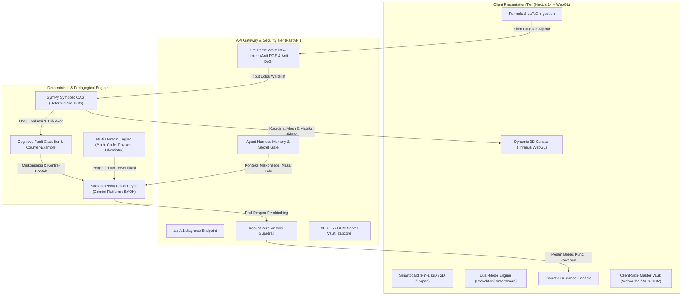

# ZAP (Zero Answer Policy) — Interactive 3D Canvas & Socratic Math Engine

[](https://github.com/wakhidpangestu/ZAP)
[](https://github.com/wakhidpangestu/ZAP)
[-2563EB?style=for-the-badge)](https://github.com/wakhidpangestu/ZAP)
[](LICENSE)
[](backend/tests/)

> **"Don't give them answers. Project the wonder to discover."**  
> ZAP adalah platform pembelajaran matematika *Web-First* yang mengubah rumus dan persamaan aljabar menjadi **bangun ruang 3D interaktif secara real-time** (Three.js/WebGL), dipandu oleh **Tutor Sokratik berpagar Zero Answer Policy**, dan diverifikasi kebenaran matematisnya secara deterministik oleh mesin aljabar simbolik (**SymPy**).

---

## 👥 1. Identitas Tim & Karya

Sesuai ketentuan resmi **Guidebook LOGICODIX 2026 (Bab Submission & Ketentuan README.md)**:

| Informasi | Keterangan |
| :--- | :--- |
| **Nama Tim** | **unindra_coders** |
| **Asal Perguruan Tinggi** | **Universitas Indraprasta PGRI (UNINDRA)** |
| **Ketua Tim** | **Rafi Budiansyah** |
| **Anggota Tim** | 1. **Wakhid Pangestu**<br>2. **Rendy Setiawan**<br>3. **Ahmad Dandi Subhani** |
| **Kategori Lomba** | **Web Application — Minimum Viable Product (MVP)** |
| **Subtema Hackathon** | **Smart & Fun Education** |
| **Nama Aplikasi / Solusi** | **ZAP (Zero Answer Policy)** |
| **Tautan Repositori GitHub**| [https://github.com/wakhidpangestu/ZAP](https://github.com/wakhidpangestu/ZAP) |
| **Akses Demonstrasi Web** | [https://chatzap.web.id](https://chatzap.web.id) *(Cermin: [chatzap.xyz](https://chatzap.xyz) / Localhost `http://localhost:3000`)* |

---

## 🎯 2. Masalah, Solusi & Target Pengguna (Problem-Solution Fit)

### A. Masalah yang Diangkat
1. **Math Blindness & Hambatan Papan Tulis 2D:** Berdasarkan skor PISA 2022, kemampuan numerasi Indonesia berada pada peringkat 69 dari 81 negara (skor 366 vs rata-rata OECD 472). Siswa kesulitan memproyeksikan konsep abstrak (irisan bangun ruang, fungsi multivariabel, pemfaktoran kuadrat) dari coretan 2D papan tulis manual.
2. **Cognitive Bypassing akibat "Answer Engine" AI:** AI generatif umum (ChatGPT, Photomath) saat ini difungsikan sebagai "mesin kunci jawaban instan". Siswa menyalin tugas sekolah, mendapat jawaban akhir seketika, dan proses bernalar kritis pun mati.
3. **Kesenjangan Perangkat (Hardware Gap):** *Interactive Smart Board* modern yang mampu merender grafik 3D di luar negeri berharga fantastis (**Rp 30 juta – Rp 80 juta per unit**), sehingga mustahil dijangkau oleh mayoritas sekolah negeri di Indonesia. Padahal, hampir setiap ruang kelas memiliki aset terpendam: **proyektor LCD gantung di plafon**.

### B. Solusi Inovatif ZAP
* **Zero Answer Policy (Pedagogi Sokratik Murni):** AI bertindak sebagai guru pembimbing yang **dilarang keras membocorkan angka kunci jawaban akhir**. Sistem memandu menggunakan perancah kognitif (*scaffolding*) berupa pertanyaan pemantik bertahap agar siswa menemukan penalarannya sendiri (*Aha! Moment*).
* **Dynamic 3D Spatial Canvas (Web-First):** Berbasis Three.js/WebGL, persamaan aljabar dan rumus geometri langsung diwujudkan menjadi model 3D hidup yang dapat diputar, diiris, dan diubah parameternya secara *real-time*.
* **Deterministik via SymPy CAS Shield:** Menjamin 0% halusinasi hitung matematika. Verifikasi aljabar dan koordinat bangun ruang diselesaikan oleh mesin aljabar komputer (CAS), bukan ditebak oleh LLM.
* **Papan Tulis Pintar Terpadu (Smartboard 2D / 3D / Coretan Kapur):** Tiga kanvas dalam satu ruang kerja dengan **persistensi state lintas tab** (objek 3D, kurva grafik 2D, dan coretan papan tidak hilang saat berpindah tab).
* **Inklusif & Hardware-Agnostic (Dual-Mode):** Berjalan mulus di **laptop guru yang terhubung ke proyektor gantung InFocus** (Mode Proyektor: kontras tinggi, font besar, tombol ramah clicker) maupun di **Smart Board layar sentuh IFP** (Mode Smart Board: gesture sentuh & stylus).

### C. Target Pengguna
1. **Siswa SD, SMP, SMA/SMK:** Membantu memvisualisasikan bangun ruang parametrik, kurva fungsi kuadrat, dan aljabar tanpa takut salah.
2. **Mahasiswa Sains & Teknik:** Meneliti irisan bidang 3D, kalkulus multivariabel $f(x,y)$, dan permukaan matematika kompleks.
3. **Guru & Pendidik Matematika:** Mengubah proyektor gantung kelas konvensional menjadi media ajar pintar interaktif yang memikat perhatian siswa.

---

## 🚀 3. Daftar Fitur Utama yang Berhasil Diimplementasikan

| Fitur Utama | Status | Deskripsi Implementasi |
| :--- | :---: | :--- |
| **Cognitive Fault Localization (CFL)** | ✅ Aktif | Verifikasi langkah demi langkah aljabar via SymPy: mendeteksi salah ekspansi kuadrat, kesalahan transposisi ruas, dan kehilangan akar (`ROOT_LOSS`). |
| **Robust Zero-Answer Guardrail** | ✅ Aktif | Penyaring kebocoran jawaban deklaratif (`x = 2`, `jawaban akhirnya`, angka diagonal ruang) tanpa merusak konteks pertanyaan pemantik Sokrates. |
| **Dynamic 3D Spatial Canvas** | ✅ Aktif | Galeri bangun ruang parametrik (kubus, prisma, limas, silinder, torus, dsb.), irisan bidang dinamis, dan penjelajah permukaan kalkulus $f(x,y)$ berbasis Three.js WebGL. |
| **Papan Tulis Pintar 3-in-1 (Persistent)** | ✅ Aktif | Kanvas geometri 3D, plotter kurva 2D, dan coretan kapur interaktif dengan pemulihan state instan saat berpindah tab kanvas. |
| **Modern Adaptive Dock & Copilot** | ✅ Aktif | Bilah alat (*floating dock*) dengan dukungan gulir horizontal (*overflow scroll*) di layar kecil serta posisi Copilot ergonomis di atas dock. |
| **Multi-Domain Verified Corpus Synthesis** | ✅ Aktif | Pipa korpus pengetahuan multi-disiplin (Matematika TK–S3, Pemrograman, Fisika, Kimia) dengan verifikasi mesin independen. |
| **Agent Memory Harness & Flywheel** | ✅ Aktif | Penyimpanan memori episodik agen Sokratik dengan isolasi penuh per-pengguna dan proteksi gerbang rahasia (*secret gate*). |
| **Dual-Tier Master Vault (AES-256-GCM)** | ✅ Aktif | Enkripsi brankas kunci API dan percakapan di sisi klien (passphrase/biometrik WebAuthn) serta di sisi server menggunakan AES-256-GCM terisolasi. |
| **Dual-Mode Class Presentation** | ✅ Aktif | Peralihan 1-klik antara **Mode Proyektor Gantung** (skema kontras tinggi, teks bimbingan ekstra besar terbaca dari baris belakang kelas) dan **Mode Smart Board IFP** (*touch targets* ≥ 48px). |
| **Universal 1-Click Connect (Google SSO)** | ✅ Aktif | Guru & siswa cukup masuk dengan 1-klik akun Google (verifikasi tokeninfo server-side) dan langsung dapat menggunakan Gemini Platform tanpa ribet setup API key. |
| **Mode Tamu Instan (Guest Access)** | ✅ Aktif | 1-klik langsung masuk ke papan tulis dan percakapan tanpa perlu registrasi maupun memasukkan kata sandi. |
| **BYOK Multi-Model AI Gateway** | ✅ Aktif | Opsi bagi pengguna/juri untuk menghubungkan kunci API mereka sendiri (OpenAI ChatGPT, Mistral, NVIDIA NIM, BazaarLink) dengan enkripsi sisi server. |
| **Developer Documentation Portal (`/docs`)** | ✅ Aktif | Halaman dokumentasi teknis interaktif, snippets multi-bahasa, dan Interactive API Playground langsung di browser. |
| **Takedown & Right to be Forgotten** | ✅ Aktif | Fitur ekspor data terenkripsi dan penghapusan akun mandiri secara menyeluruh (*GDPR-compliant*). |

---

## 🏗️ 4. Arsitektur Sistem & Alur Data

ZAP mengusung arsitektur **Strict Separation of Concerns** yang memisahkan ranah persepsi spasial 3D, ranah kebenaran matematika deterministik, dan ranah dialog pedagogis Sokratik:



---

## 🛠️ 5. Teknologi yang Digunakan

| Layer / Kategori | Komponen & Pustaka | Lisensi | Fungsi & Peran |
| :--- | :--- | :--- | :--- |
| **Frontend Framework** | Next.js 14 (App Router), React 18, TypeScript 5 | MIT | Arsitektur web modern, SSR/SSG teroptimasi, routing dinamis. |
| **3D Graphics & Canvas** | Three.js 0.187, WebGL, Canvas 2D | MIT | Mesin visualisasi WebGL 3D, kontrol orbit kamera, irisan bangun ruang, dan kurva 2D. |
| **UI Styling & Motion** | Tailwind CSS v3, Framer Motion, GSAP 3.15, Lucide React | MIT / ISC | Desain responsif, docking bar animasi halus, tema gelap/terang, tipografi matematika presisi. |
| **Mathematical Typesetting** | KaTeX 0.19, react-katex | MIT | Rendering persamaan LaTeX kilat di sisi peramban. |
| **Backend Framework** | FastAPI 0.162, Uvicorn, Python 3.15 | MIT / BSD | Microservice asynchronous berperforma tinggi dengan validasi schema Pydantic v2. |
| **Computer Algebra (CAS)** | SymPy 1.14.0, mpmath, antlr4-python3 | BSD-3-Clause | Arbiter tunggal kebenaran matematika, pemecah persamaan, dan kalkulator kontra-contoh. |
| **Keamanan & Kriptografi** | Cryptography 50.0.2 (AES-256-GCM, SHA-256) | Apache / BSD | Enkripsi brankas kredensial pengguna, isolasi memori, dan perlindungan privasi. |
| **Testing Framework** | Pytest 9.2.0, AnyIO, Starlette TestClient | MIT | Pengujian regresi otomatis, audit parser, dan simulasi serangan injeksi. |
| **Database & Cache** | SQLite 3 (`zap_platform.db` & `zap_math_corpus.db`), LocalStorage | Public Domain | Penyimpanan pengguna terenkripsi, korpus materi ajar, memori episodik, dan sesi kerja. |
| **Layanan AI Eksternal** | Google Gemini (2.0 Flash / 1.5 Flash), OpenAI, Mistral | Komersial API | Dialog pembimbing Sokratik berbasis arahan terstruktur. |

### A. Frontend Documentation (Framework, Struktur Komponen UI & Aset)

* **Framework:** Next.js 14 (App Router), React 18, TypeScript 5, Tailwind CSS v3, Three.js 0.187.
* **Struktur Komponen UI Utama (`frontend/components/`):**
  * `InteractiveCanvas3D.tsx`: Komponen utama kanvas 3D spasial Three.js WebGL, Papan Tulis Pintar 3-in-1 (3D solid, 2D calculus curves, chalkboard), orbit controls, dan kursor kolaboratif multi-pengguna.
  * `landing/ZapChatPreview.tsx` & `ZapChatScrollHero.tsx`: Pratinjau dialog Sokratik interaktif dan scroll hero showcase modern.
  * `MathView.tsx`: Renderer persamaan matematika KaTeX berlatensi rendah di sisi peramban.
  * `ModelPicker.tsx`: Antarmuka pemilihan model AI (Gemini 2.0 Flash bawaan, Claude, OpenAI GPT-4o, Ollama lokal) dengan enkripsi BYOK.
  * `Navigation.tsx` & `ZapLogo.tsx`: Header navigasi responsif, tombol peralihan Mode Proyektor, dan identitas brand.
* **Struktur Aset (`assets/` & `frontend/public/`):**
  * `assets/zappy-mascot/`: Maskot 3D resmi "ZAPPY" (model glTF 2.0 prosedural PBR: `out/zapy_*.glb` dan ekspresi wajah `out/zapy_head_*.glb`).
  * `frontend/public/`: Ikonografi SVG, font matematika KaTeX, dan manifest PWA.

### B. Backend Documentation (API Endpoints, Database Schema & .env.example)

* **API Endpoints Utama (FastAPI - Port 8000 & 8001):**

| Method | Endpoint | Fungsi, Validasi & Guardrail |
| :--- | :--- | :--- |
| `POST` | `/api/v1/diagnose` | Evaluasi aljabar simbolik via SymPy CAS: mendeteksi kesalahan transposisi, ekspansi kuadrat, akar hilang, serta menyaring keluaran via Zero-Answer Guardrail. |
| `GET` | `/health` | Pemeriksaan ketersediaan layanan (*health check*) microservice backend. |
| `GET` | `/api/v1/stats` | Statistik anonim agregat diagnostik dan efisiensi CFL. |
| `POST` | `/api/v1/learn` | Perekaman memori episodik agen Sokratik dengan isolasi pengguna per-sesi. |
| `POST` | `/api/v1/auth/google` | Verifikasi server-side token Google OAuth2 SSO dan penerbitan sesi JWT. |
| `POST` | `/api/v1/vault/encrypt` | Enkripsi brankas kunci API pengguna (BYOK) menggunakan AES-256-GCM. |
| `POST` | `/api/v1/vault/decrypt` | Dekripsi aman kunci API pengguna dalam sandbox server saat request AI. |

* **Database & Storage Schema:**
  * **SQLite Database (`zap_platform.db`):**
    * Tabel `users`: `id (TEXT PRIMARY KEY)`, `email (TEXT UNIQUE)`, `name (TEXT)`, `role (TEXT)`, `created_at (TIMESTAMP)`, `last_login (TIMESTAMP)`.
    * Tabel `user_secrets`: `user_id (TEXT)`, `provider (TEXT)`, `encrypted_payload (TEXT)`, `iv (TEXT)`, `tag (TEXT)`, `updated_at (TIMESTAMP)`.
    * Tabel `sessions`: `token (TEXT PRIMARY KEY)`, `user_id (TEXT)`, `expires_at (TIMESTAMP)`.
  * **Knowledge & Geometry Schemas:**
    * `data/zap_geometry_database.json`: Katalog relasional bangun ruang parametrik (kubus, balok, prisma, limas, silinder, kerucut, bola) lengkap dengan formula volume $V$ dan luas permukaan $L_p$.
    * `data/zap_agent_memory.jsonl`: Basis data log pembelajaran percakapan terisolasi per-pengguna.
* **Konfigurasi Environment:** Seluruh parameter lingkungan terdokumentasi lengkap pada template [`.env.example`](.env.example) (lihat [Bagian 8](#-8-daftar-variabel-lingkungan-envexample)).

---

## 🧪 6. Hasil Uji Otomatis (Pytest 126/126 Verified)

Seluruh logika aljabar deterministik, pertahanan injeksi kode, batas eksponen DoS, isolasi memori agen, sintesis korpus multi-domain, dan keamanan platform telah diverifikasi melalui **126 unit test otomatis (100% lulus)**:

```powershell
# Menjalankan seluruh pengujian (126/126 lolos)
python -m pytest -v -p no:cacheprovider tests/ tests_platform/
============================= 126 passed in 5.40s =============================
```

### Rincian Modul Pengujian:

#### 1. Core Symbolic Reasoning, Harvester & Memory Isolation (`backend/tests/` — 84 Tests Lolos):
* ✅ **Cognitive Fault Localization:**
  * Verifikasi ekspansi kuadrat patah: $(x+3)^2 - 4 \rightarrow x^2 + 5$ mendeteksi hilangnya suku perkalian silang ($21 \neq 9$).
  * Validasi pemindahan ruas persamaan linear ($2x+3=7 \rightarrow 2x=4 \rightarrow x=2$).
  * Deteksi galat tanda saat transposisi suku aljabar ($2x+3=7 \rightarrow 2x=10$).
  * Deteksi kehilangan akar (`ROOT_LOSS`) pada persamaan kuadrat ($x^2 = 4 \rightarrow x = 2$).
  * Penanganan `ConditionSet` transendental $\sin(x) = x$ secara aman (`UNDECIDABLE_STEP`).
* ✅ **Anti-RCE Whitelist Security:**
  * Memblokir injeksi kode Python (`__import__`, `eval`, `open`, `__builtins__`) pada tahap pra-parsing sebelum menyentuh fungsi `parse_expr` SymPy.
* ✅ **Anti-LaTeX Exploit:**
  * Menolak perintah eksekusi berbahaya seperti `\input{/etc/passwd}` dan `\write18{echo hi}`.
* ✅ **Anti-DoS Exponential Limiter:**
  * Menolak kiriman pangkat bertingkat raksasa ($9^{9^9}$, $(9^9)^9$, $2^{100000000000}$) dengan ambang batas eksponen $\le 100$ dalam sub-milidetik (< 1 ms).
* ✅ **Zero-Answer Guardrail:**
  * Menyaring pernyataan deklaratif jawaban akhir (`x = 2`, `jawaban akhirnya`, angka diagonal ruang) tanpa merusak kalimat pembimbing Sokratik.
* ✅ **Multi-Domain Machine-Verified Corpus:**
  * Menjamin tidak ada kebocoran jawaban akhir pada pertanyaan, bimbingan Sokratik, maupun petunjuk untuk subtopik Pemrograman, Fisika, dan Kimia.
  * Sandbox eksekusi kode pemrograman aman dari masukan berbahaya.
* ✅ **Agent Memory Harness & Isolation:**
  * Isolasi data pembelajaran per-pengguna (Pengguna B tidak pernah dapat melihat riwayat memori Pengguna A).
  * Proteksi endpoint statistik dan pembelajaran melalui *secret gate*.
  * Sinkronisasi transaksi paralel SQLite dan *jsonl mirror* tanpa kehilangan baris.

#### 2. Platform Security, Auth SSO & Vault (`backend/tests_platform/` — 42 Tests Lolos):
* ✅ **Autentikasi Google SSO Server-Side:**
  * Verifikasi tanda tangan token Google (memeriksa audiens, masa berlaku, dan status `email_verified`).
* ✅ **Master Vault AES-256-GCM:**
  * Enkripsi roundtrip kunci API pihak ketiga dengan garam acak 12-byte IV dan isolasi per-pengguna.
* ✅ **Multi-Model Gateway:**
  * Perutean permintaan ke Gemini Platform, OpenAI, Mistral, atau Anthropic (via BYOK) dengan penanganan kegagalan (*failover*).
* ✅ **Privasi & Kebijakan Data:**
  * Filter PII (NIK ditolak seketika, alamat email disanitasi).
  * Ekspor data terenkripsi dan penghapusan menyeluruh (*Right to be Forgotten*).

---

## 💻 7. Petunjuk Localhost (Instalasi & Menjalankan di Laptop Finalis)

### Kebutuhan Lingkungan:
* **Python:** Versi **3.10** s/d **3.15** (Direkomendasikan Python 3.15 x86-64).
* **Node.js:** Versi **v18.x** s/d **v24.x** (Direkomendasikan Node.js v20+).
* **Git:** Versi terbaru.

### Langkah 1: Kloning Repositori
```bash
git clone https://github.com/wakhidpangestu/ZAP.git
cd ZAP
```

### Langkah 2: Konfigurasi File Environment (`.env.example`)
Salin template konfigurasi variabel lingkungan yang telah disediakan:
```powershell
# Salin konfigurasi backend
copy backend\.env.example backend\.env

# Salin konfigurasi frontend
copy frontend\.env.example frontend\.env.local
```
*(Lihat bagian [Daftar Variabel Lingkungan](#-daftar-variabel-lingkungan-envexample) untuk keterangan setiap variabel).*

### Langkah 3: Setup & Menjalankan Backend (FastAPI + SymPy CAS)
Buka terminal pertama:
```powershell
cd backend
python -m venv venv
.\venv\Scripts\Activate.ps1
pip install -r requirements.txt

# Jalankan seluruh pengujian verifikasi (126 tests)
python -m pytest -v -p no:cacheprovider tests/ tests_platform/

# Jalankan layanan backend CFL (Port 8000)
uvicorn main:app --reload --port 8000
```
Layanan diagnostik CFL akan aktif di `http://127.0.0.1:8000` (dokumentasi Swagger di `http://127.0.0.1:8000/docs`).

*(Opsional) Bila ingin menjalankan layanan platform Zapcore (Auth Google terverifikasi, Vault, & Kurasi) di terminal terpisah:*
```powershell
uvicorn platform_main:app --reload --port 8001
```

### Langkah 4: Setup & Menjalankan Frontend (Next.js 14 + Three.js)
Buka terminal kedua:
```powershell
cd frontend
npm install
npm run dev
```
Aplikasi web ZAP siap diakses di peramban pada **`http://localhost:3000`**.

---

## 🔑 8. Daftar Variabel Lingkungan (`.env.example`)

Sesuai instruksi Buku Panduan (Halaman 17 & 20), berikut adalah parameter konfigurasi yang disediakan dalam file template [`.env.example`](.env.example):

| Variabel | Lingkup | Deskripsi | Nilai Default / Contoh |
| :--- | :--- | :--- | :--- |
| `NEXT_PUBLIC_BACKEND_URL` | Frontend | URL endpoint backend microservice ZAP | `http://127.0.0.1:8000` *(atau endpoint produksi)* |
| `NEXT_PUBLIC_GOOGLE_CLIENT_ID` | Frontend | Client ID Google Identity Services untuk SSO web | `[your_google_client_id].apps.googleusercontent.com` |
| `ZAP_GOOGLE_CLIENT_ID` | Backend | Client ID OAuth Google untuk verifikasi server-side token | `[your_google_client_id].apps.googleusercontent.com` |
| `ZAP_GOOGLE_CLIENT_SECRET` | Backend | Client Secret OAuth Google | `your_google_client_secret` |
| `ZAP_JWT_SECRET` | Backend | Kunci rahasia penanda tangan sesi JWT | `your_jwt_secret_key_change_me` |
| `ZAP_MASTER_SECRET` | Backend | Passphrase master enkripsi AES-256-GCM vault | `your_master_secret_passphrase` |
| `ZAP_GEMINI_API_KEY` | Backend | Kunci API Gemini milik server platform | `your_platform_gemini_api_key` |
| `ZAP_DB_PATH` | Backend | Lokasi berkas SQLite basis data pengguna & platform | `zap_platform.db` |
| `ZAP_SESSION_DAYS` | Backend | Masa berlaku token sesi pengguna (hari) | `7` |
| `ZAP_RETENTION_DAYS` | Backend | Periode retensi data sebelum pembersihan otomatis | `365` |
| `BAZAARLINK_API_KEY` | Frontend (Opsional) | Kunci API opsional untuk connector BazaarLink | *(Kosongkan bila tidak digunakan)* |
| `MISTRAL_API_KEY` | Frontend (Opsional) | Kunci API opsional untuk connector Mistral AI | *(Kosongkan bila tidak digunakan)* |
| `NVIDIA_API_KEY` | Frontend (Opsional) | Kunci API opsional untuk connector NVIDIA NIM | *(Kosongkan bila tidak digunakan)* |

---

## 👤 9. Akun Demonstrasi & Pengujian Juri

Sesuai regulasi Buku Panduan LOGICODIX 2026: **"Juri tidak boleh diwajibkan membayar, berlangganan, atau memiliki akses khusus untuk menjalankan fitur utama"**:

### Opsi 1: Mode Tamu Instan (Paling Mudah — 1 Klik Langsung Masuk)
1. Buka halaman login di `http://localhost:3000/login` (atau `https://chatzap.xyz/login`).
2. Masukkan nama Anda (misal: `"Dewan Juri LOGICODIX"`), pilih peran (*Pendidik/Siswa*), lalu klik tombol **"Masuk sebagai Siswa Tamu"**.
3. Sistem seketika membuka kanvas 3D dan ruang chat tanpa memerlukan registrasi kata sandi atau setup token apa pun.

### Opsi 2: Mode Google 1-Click SSO (Gemini Platform Otomatis Aktif)
1. Pada halaman login, klik tombol **"Sign in with Google"**.
2. Masuk menggunakan akun Google Anda.
3. Begitu berhasil masuk, kuota **Google Gemini Platform ZAP** langsung otomatis aktif di sisi server. Anda dapat langsung menguji penalaran Sokratik tanpa perlu memasukkan API key pribadi.

### Opsi 3: Kredensial Akun Demonstrasi Pengujian (Demo Account)
Bila diperlukan untuk skenario pengujian kredensial terstandarisasi:
* **Email Akun Demo:** `juri.logicodix2026@student.zap`
* **Nama Tampilan:** `Juri Kehormatan Logicodix`
* **Peran:** `Pendidik / Juri`
* **Status:** `Aktif (Hak Akses Penuh ke Kanvas 3D, Guardrail, & Diagnosa Aljabar)`

---

## 🤖 10. Dokumentasi Penggunaan AI (Transparansi & Etika Digital)

Sesuai ketentuan resmi **Buku Panduan LOGICODIX 2026 (Halaman 16, 20 & Rubrik Etika Digital 10%)**:

### A. Layanan & Model AI yang Digunakan
1. **Google Gemini 2.0 Flash / 1.5 Flash:** Model bahasa bawaan platform ZAP yang bertindak sebagai fasilitator pedagogis percakapan.
2. **OpenAI GPT-4o / Mistral Large (via BYOK Connector):** Opsi alternatif yang dapat dihubungkan pengguna melalui antarmuka Connector.

### B. Bagian Produk yang Memanfaatkan AI
AI dimanfaatkan secara spesifik dan terisolasi pada **Socratic Pedagogical Dialogue Layer**:
* AI menerima data terstruktur hasil temuan dari SymPy CAS (misalnya: *“Terdeteksi kesalahan ekspansi kuadrat di baris ke-2; kontra-contoh: x=2 menghasilkan 21 ≠ 9”*).
* AI bertugas menerjemahkan data matematis tersebut menjadi kalimat empati dan pertanyaan penuntun (*scaffolding*), misalnya:  
  *“Perhatikan baris ke-2 pada ekspansi $(x+3)^2$. Jika kita substitusi nilai $x = 2$, berapakah hasil dari $(2+3)^2$? Apakah sama dengan $2^2 + 9$?”*

### C. Pembatasan Ketat & Etika AI (*Immutable Safeguards*)
1. **Strict Separation of Concerns (Anti-Halusinasi):** LLM **tidak pernah diperkenankan menghitung nilai numerik aljabar** atau memutuskan apakah suatu persamaan matematika valid. Seluruh verifikasi matematika 100% didelegasikan ke mesin simbolik deterministik **SymPy CAS**.
2. **Robust Zero-Answer Guardrail:** Seluruh keluaran teks AI wajib melewati modul filter `RobustZeroAnswerGuardrail.sanitize()`. Jika model mencoba membocorkan nilai akhir persamaan, guardrail akan menyensornya secara otomatis.
3. **Privasi & Consent:** Tidak ada data obrolan pengguna yang digunakan untuk melatih (*retrain*) model AI tanpa persetujuan eksplisit (*Zero Data Retention by default*).

---

## 📜 11. Atribusi Pihak Ketiga & Orisinalitas Karya

Sesuai regulasi Buku Panduan (Halaman 16 & 20), seluruh pustaka, template, aset, dan dataset pihak ketiga diatribusikan secara transparan:

1. **Framework & Web:** [Next.js](https://nextjs.org/) oleh Vercel (Lisensi MIT), [React](https://react.dev/) oleh Meta (Lisensi MIT).
2. **Visualisasi 3D WebGL:** [Three.js](https://threejs.org/) oleh Ricardo Cabello / Mr.doob (Lisensi MIT), [@react-three/fiber](https://github.com/pmndrs/react-three-fiber) oleh Poimandres (Lisensi MIT).
3. **Komputasi Aljabar Simbolik:** [SymPy](https://www.sympy.org/) oleh SymPy Development Team (Lisensi BSD-3-Clause).
4. **Antarmuka & Ikonografi:** [Tailwind CSS](https://tailwindcss.com/) oleh Tailwind Labs (Lisensi MIT), [Lucide Icons](https://lucide.dev/) oleh Lucide Contributors (Lisensi ISC).
5. **Tipografi Matematika:** [KaTeX](https://katex.org/) oleh Khan Academy (Lisensi MIT).
6. **Autentikasi & Layanan Cloud:** [Google Identity Services SDK](https://developers.google.com/identity) oleh Google LLC.
7. **Dataset Terbuka:** [GSM8K Benchmark](https://github.com/openai/grade-school-math) oleh OpenAI (Lisensi MIT) untuk acuan taksonomi aljabar di modul `data_engine`.
8. **Orisinalitas Logika Inti:** Algoritma *Cognitive Fault Localization (CFL)*, parser whitelist anti-RCE, pembatas eksponen anti-DoS, pelindung Zero-Answer Guardrail, Papan Tulis Pintar 3-in-1 berpersistensi state, galeri bangun ruang parametrik 3D, dan arsitektur brankas ganda AES-256-GCM merupakan **karya orisinal yang dirancang dan dikembangkan sendiri oleh tim `unindra_coders`**.

---

## 📁 12. Struktur Repositori Terorganisir

```text
logicodix/
├── .agents/skills/           # Unified AI Agent Skill & Harness untuk otomasi & upgrade ZAP
│   └── zap-skills/           # Master Skill: Agent Memory Harness, Web Crawler, Multi-Domain Synthesis
├── .codex/                   # Codex assistant configurations
├── assets/                   # Aset grafis visual & maskot resmi ZAP
├── backend/                  # Layanan Backend FastAPI & SymPy Reasoning CAS
│   ├── cfl/                  # Core Cognitive Fault Localization (Parser, Classifier, Guardrail)
│   ├── data_engine/          # Agent Memory Harness, Multi-Domain Corpus & Kurikulum (TK–S3)
│   ├── zapcore/              # Auth SSO, AES-256-GCM Vault, Multi-Model Gateway, Privacy
│   ├── tests/                # 84 Automated Tests: verifikasi aljabar, anti-RCE, DoS, multi-domain, memory
│   ├── tests_platform/       # 42 Automated Tests: auth tokeninfo, vault crypto & privasi
│   ├── main.py               # Titik masuk Microservice CFL Engine (Port 8000)
│   ├── platform_main.py      # Titik masuk Zapcore Platform Services (Port 8001)
│   ├── .env.example          # Template konfigurasi variabel lingkungan backend
│   └── requirements.txt      # Daftar dependensi produksi Python
├── data/                     # Basis data geometri parametrik, memori agen & korpus matematika
│   ├── zap_agent_memory.jsonl     # Memori episodik pembelajaran percakapan agen ZAP
│   ├── zap_geometry_database.json # Katalog bangun ruang, sudut, rusuk, & rumus
│   ├── zap_math_corpus.jsonl      # Korpus aljabar & teorema terverifikasi (TK hingga S3)
│   └── harvest_state.json         # Metadata statistik proses kurasi & verifikasi data
├── docs/                     # Dokumentasi arsitektur, spesifikasi teknis, & blueprint resmi
│   ├── README.md             # Indeks utama seluruh dokumentasi teknis
│   ├── ARCHITECTURE.md       # Arsitektur sistem & diagram data flow
│   ├── ALGORITHM.md          # Spesifikasi matematika simbolik CFL & mitigasi DoS
│   ├── BACKEND_SYSTEM.md     # Desain sistem backend, auth Google, & vault kriptografi
│   ├── DATA_AND_LEARNING_POLICY.md # Kebijakan kurasi data & hak privasi
│   ├── DEPLOYMENT_GUIDE.md   # Panduan deployment produksi, Docker, SSL & environment
│   ├── DESIGN_SYSTEM.md      # UI/UX design tokens & spesifikasi Dual-Mode
│   ├── PRIVACY_POLICY.md     # Kebijakan privasi resmi platform ZAP
│   ├── TERMS_OF_SERVICE.md   # Ketentuan penggunaan layanan edukasi
│   ├── ZAP_Product_Blueprint.pdf   # Blueprint produk resmi 4 halaman (Light Mode Minimalis)
│   └── ZAP_Product_Blueprint.html  # Edisi web interaktif dokumen blueprint
├── frontend/                 # Aplikasi Web Next.js 14 + Tailwind CSS + Three.js
│   ├── app/                  # App Router (Halaman Chat, Connector, Login, Docs, Unban)
│   ├── components/           # Komponen UI, Kanvas 3D Interaktif, MathView, ModelPicker, Dock
│   ├── data/                 # Basis data geometri sisi klien untuk kalkulasi kanvas cepat
│   ├── utils/                # Sinkronisasi akun, chat memory windowing & enkripsi lokal
│   ├── .env.example          # Template konfigurasi variabel lingkungan frontend
│   └── package.json          # Dependensi produksi Node.js
├── scripts/                  # Skrip otomasi korpus matematika & generator dokumen
│   ├── fetch_math_data.py    # Generator & harvester korpus matematika
│   └── generate_blueprint_pdf.py # Generator PDF blueprint resmi 4 halaman
├── tests/                    # Forwarder pytest root (eksekusi pytest langsung dari root)
├── trash/                    # Arsip lokal berkas usang & dokumen audit (diabaikan Git)
├── .env.example              # Template variabel lingkungan utama repositori
├── .gitignore                # Aturan pengecualian berkas sistem, trash, database & kredensial
├── AGENTS.md                 # Kontrak operasional agen AI & memori teruji sistem
├── docker-compose.yml        # Konfigurasi container orkestrasi backend & frontend
└── README.md                 # Dokumentasi utama repositori resmi LOGICODIX 2026
```

---

## ⚖️ 13. Kepatuhan Terhadap Regulasi LOGICODIX 2026

Repositori ini mematuhi seluruh ketentuan yang tercantum dalam **Buku Panduan LOGICODIX 2026**:
* ✅ **Batas Akhir Submission (Code Freeze):** Seluruh kode diselesaikan dan dibekukan sebelum batas akhir 14 November 2026 pukul 23.59 WIB.
* ✅ **Keamanan Kredensial:** Repositori 100% bebas dari kunci API rahasia atau password ter-hardcode. Seluruh rahasia dikelola melalui variabel lingkungan dengan template [`.env.example`](.env.example).
* ✅ **Riwayat Commit Teratur:** Setiap commit menggunakan format konvensional (`feat:`, `fix:`, `refactor:`, `docs:`) yang mencerminkan perkembangan nyata selama Hacking Week tanpa *bulk upload*.
* ✅ **Aksesibilitas Pengujian Juri:** Aplikasi dapat diakses langsung via web publik ([chatzap.xyz](https://chatzap.xyz)) maupun dijalankan secara lokal di laptop pada saat babak Grand Final luring.
* ✅ **Standar Etika & Transparansi:** Transparansi penuh atas pemanfaatan AI, atribusi pustaka pihak ketiga, dan perlindungan privasi data siswa.
